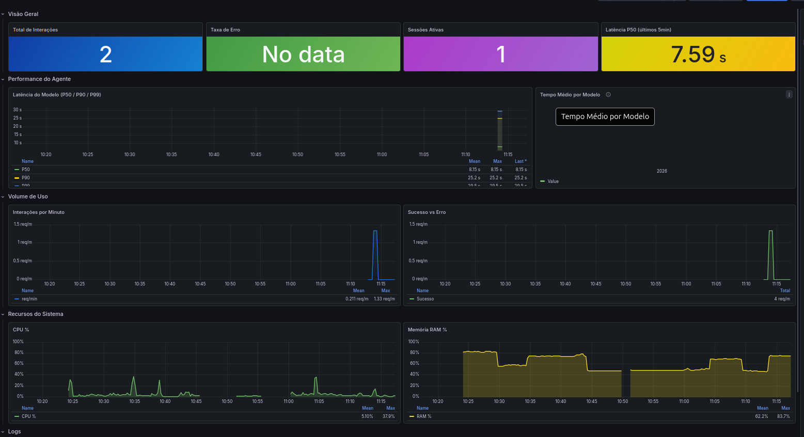

# Agente Conversacional com Stack de Observabilidade

Trabalho de Conclusão de Curso — Implementação de um agente conversacional baseado em LLM local com uma stack completa de observabilidade (logs, métricas e rastreamento distribuído).

---

## Visão Geral

O projeto consiste em um assistente virtual da **AMOBEN** (Associação de Moradores do Bairro Estrada Nova), restrito a responder apenas perguntas sobre a associação e o bairro. Toda a infraestrutura é instrumentada com as três pilares de observabilidade:

- **Logs estruturados** — JSON via `python-json-logger` → Promtail → Loki
- **Métricas** — `prometheus-client` exposto no FastAPI → Prometheus → Grafana
- **Rastreamento distribuído** — OpenTelemetry SDK → Jaeger via OTLP/gRPC
- **Persistência de conversas** — sessões autenticadas e mensagens armazenadas em MySQL
- **Busca no bairro** — estabelecimentos do OpenStreetMap próximos ao centro fixo da Estrada Nova

---

## Arquitetura

```
┌─────────────────────────────────────────────────────┐
│                   Cliente (Browser)                  │
│              http://localhost:3001                   │
└──────────────────────┬──────────────────────────────┘
                       │
              ┌────────▼────────┐
              │    Frontend     │  React + Vite → nginx
              │   (porta 3001)  │
              └────────┬────────┘
                       │ /chat  /export
              ┌────────▼────────┐
              │     Backend     │  FastAPI + LangChain + Ollama
              │   (porta 8080)  │  gemma3:4b (host)
              └──┬──────┬───┬───┘
                 │      │   │
         logs/  │   métricas  traces
         .log   │   /metrics  OTLP gRPC
                 │      │   │
    ┌────────────▼┐  ┌───▼───▼──┐  ┌────────┐
    │  Promtail   │  │Prometheus │  │ Jaeger │
    └──────┬──────┘  └────┬──────┘  │(16686) │
           │              │         └────────┘
    ┌──────▼──────┐  ┌────▼──────────────────┐
    │    Loki     │  │        Grafana         │
    │  (3100)     │  │       (3000)           │
    └─────────────┘  └───────────────────────┘
```

O MySQL é acessível apenas pelos containers na rede interna do Docker Compose. Ele
não publica a porta `3306` no host.

---

## Pré-requisitos

- [Docker](https://docs.docker.com/get-docker/) e Docker Compose
- [Ollama](https://ollama.com) instalado e rodando no host com o modelo `gemma3:4b`

```bash
# instalar o modelo
ollama pull gemma3:4b
```

O Ollama precisa escutar em `0.0.0.0` para ser acessível pelo container:

```bash
# criar override do systemd
sudo mkdir -p /etc/systemd/system/ollama.service.d
sudo tee /etc/systemd/system/ollama.service.d/override.conf <<EOF
[Service]
Environment="OLLAMA_HOST=0.0.0.0"
EOF

sudo systemctl daemon-reload
sudo systemctl restart ollama
```

---

## Como rodar

```bash
# clonar o repositório
git clone <url-do-repo>
cd Projeto-Tcc

# criar a configuração local e trocar as senhas de exemplo
cp .env.example .env

# subir toda a stack
docker compose up -d --build
```

Antes de subir a stack, edite o `.env` e substitua `DB_PASSWORD` e
`MYSQL_ROOT_PASSWORD` por senhas fortes e diferentes. O arquivo `.env` é local e
não deve ser versionado.

Na primeira vez o Docker vai baixar as imagens e compilar o frontend React — pode demorar alguns minutos.

---

## Serviços e portas

| Serviço | URL | Descrição |
|---|---|---|
| Frontend | http://localhost:3001 | Chat com o agente |
| Backend API | http://localhost:8080 | FastAPI (métricas em `/metrics`) |
| MySQL | Sem porta publicada | Sessões e histórico de conversas |
| Grafana | http://localhost:3000 | Dashboards (admin / admin) |
| Prometheus | http://localhost:9091 | Métricas brutas |
| Jaeger | http://localhost:16686 | Rastreamento distribuído |
| Loki | http://localhost:3100 | API de logs (sem UI) |

---

## Dashboard de Observabilidade

O dashboard **AMOBEN — Agente Conversacional** é provisionado automaticamente no Grafana ao iniciar a stack.



**Painéis disponíveis:**

| Seção | Painéis |
|---|---|
| Visão Geral | Total de interações · Taxa de erro · Sessões ativas · Latência P50 |
| Performance do Agente | Latência P50/P90/P99 ao longo do tempo · Tempo médio por modelo |
| Volume de Uso | Interações por minuto · Sucesso vs Erro |
| Recursos do Sistema | CPU % · Memória RAM % |
| Logs | Distribuição por nível (donut) · Erros recentes |

---

## Estrutura do projeto

```
Projeto-Tcc/
├── backend/
│   ├── app.py              # FastAPI + LangChain + observabilidade
│   ├── database.py         # Persistência e autenticação das sessões no MySQL
│   ├── places.py           # Busca de estabelecimentos no OpenStreetMap
│   ├── system_prompt.txt   # Prompt do agente AMOBEN
│   ├── requirements.txt
│   └── Dockerfile
├── frontend/
│   ├── src/
│   │   ├── components/
│   │   │   ├── Chat.jsx        # Interface do chat
│   │   │   └── ExportButton.jsx # Exportação JSON/CSV
│   │   └── services/api.js     # Comunicação com o backend
│   ├── nginx.conf
│   └── Dockerfile
├── observability/
│   ├── prometheus.yml
│   ├── loki-config.yml
│   ├── promtail-config.yml
│   └── grafana/
│       ├── provisioning/
│       │   ├── datasources/    # Prometheus, Loki, Jaeger
│       │   └── dashboards/
│       └── dashboards/
│           └── amobem.json     # Dashboard provisionado
├── logs/                       # Logs gerados pelo agente (volume)
├── .env.example                # Modelo das variáveis locais
└── docker-compose.yml
```

---

## Variáveis de ambiente

| Variável | Padrão | Descrição |
|---|---|---|
| `OLLAMA_BASE_URL` | `http://host.docker.internal:11434` | Endpoint do Ollama |
| `OLLAMA_MODEL` | `gemma3:4b` | Modelo de linguagem utilizado |
| `JAEGER_ENDPOINT` | `http://jaeger:4317` | Endpoint OTLP do Jaeger |
| `DB_HOST` | `mysql` | Nome do serviço MySQL na rede interna |
| `DB_PORT` | `3306` | Porta interna do MySQL |
| `DB_NAME` | `amoben` | Banco usado pela aplicação |
| `DB_USER` | `amoben_app` | Usuário da aplicação, sem uso da conta root |
| `DB_PASSWORD` | sem valor seguro padrão | Senha do usuário da aplicação |
| `MYSQL_ROOT_PASSWORD` | sem valor seguro padrão | Senha administrativa usada na inicialização do MySQL |
| `SESSION_TTL_HOURS` | `24` | Validade do token de uma sessão, em horas |
| `OVERPASS_URL` | `https://overpass-api.de/api/interpreter` | API usada para consultar dados do OpenStreetMap |
| `OVERPASS_FALLBACK_URL` | `https://overpass.private.coffee/api/interpreter` | Servidor de reserva; vazio desativa a reserva |
| `NEIGHBORHOOD_CENTER_LAT` | `-26.4700649` | Latitude do ponto `place=suburb` da Estrada Nova no OpenStreetMap |
| `NEIGHBORHOOD_CENTER_LON` | `-49.1264936` | Longitude do ponto central do bairro |
| `NEIGHBORHOOD_SEARCH_RADIUS_METERS` | `1800` | Raio da área de busca a partir do centro fixo |
| `PLACE_SEARCH_TIMEOUT_SECONDS` | `15` | Limite solicitado à API para executar uma consulta, reduzido conforme o tempo disponível por tentativa |
| `PLACE_SEARCH_TOTAL_TIMEOUT_SECONDS` | `18` | Limite total da busca, incluindo conexão, leitura, novas tentativas e pausas |
| `PLACE_SEARCH_CACHE_TTL_SECONDS` | `600` | Tempo de cache das buscas por categoria |
| `PLACE_SEARCH_MAX_RESULTS` | `5` | Máximo de locais devolvidos por busca |

## Busca de estabelecimentos na Estrada Nova

A busca faz no máximo três tentativas sequenciais, alternando o servidor principal
e o de reserva, com pausas de 0,5 e 1 segundo. Todas as tentativas compartilham o
limite total de 18 segundos; cada uma tem no máximo um terço desse tempo. Respostas
em cache continuam imediatas. Erros temporários de rede ou sobrecarga permitem nova
tentativa; erros de consulta, como HTTP 400, encerram a busca. `Retry-After` e um
intervalo mínimo de 30 segundos para HTTP 406/429 impedem repetir uma chamada ao
mesmo servidor durante essa busca. Se o intervalo não cabe no limite, usa-se o
outro servidor ou encerra-se a busca. Os logs registram servidor, tentativa,
tipo de erro e código HTTP. Uma busca que esgota as tentativas conta como erro nas
métricas, mantendo a mensagem de indisponibilidade no chat.

Perguntas como “bons cafés na Estrada Nova”, “onde há farmácia?” ou “quais
mercados existem no bairro?” consultam o OpenStreetMap em tempo real. A posição
do usuário não é solicitada nem enviada ao backend: todas as buscas usam o ponto
fixo do bairro configurado no `.env`.

Como o OpenStreetMap possui um ponto para a Estrada Nova, mas não um polígono de
limite do bairro, a aplicação usa centro e raio. Locais explicitamente marcados
como pertencentes a outro bairro são descartados. Os resultados são ordenados
por distância, e não por avaliação; o cadastro público pode estar incompleto.
A prévia continua usando o mapa aberto, enquanto o clique na localização abre o
Google Maps por uma URL gratuita que não exige chave de API.

## Proteção e persistência das conversas

O navegador não cria mais o identificador da sessão sozinho. Primeiro, ele pede
ao backend uma sessão nova:

```bash
curl -X POST http://localhost:8080/sessions
```

A resposta contém um identificador, um token secreto e o horário de expiração:

```json
{
  "session_id": "...",
  "session_token": "...",
  "expires_at": "..."
}
```

O token precisa ser enviado como Bearer tanto no chat quanto na exportação:

```bash
curl -X POST http://localhost:8080/chat \
  -H 'Content-Type: application/json' \
  -H 'Authorization: Bearer SEU_SESSION_TOKEN' \
  -d '{"session_id":"SEU_SESSION_ID","message":"Olá"}'

curl http://localhost:8080/export/SEU_SESSION_ID \
  -H 'Authorization: Bearer SEU_SESSION_TOKEN'
```

Conhecer apenas o `session_id` não autoriza ler, continuar ou exportar a
conversa. Trate `session_token` como uma senha: não o coloque em URLs, logs ou
mensagens compartilhadas. A validade é configurada por `SESSION_TTL_HOURS`.

Sessões e mensagens ficam no volume nomeado `mysql_data`, portanto sobrevivem a
reinicializações dos containers e a `docker compose down`. O volume só é apagado
explicitamente, por exemplo com `docker compose down -v`.

### Testes de segurança das sessões

```bash
python -m pip install -r backend/requirements-dev.txt
python -m pytest backend/tests
```

A suíte verifica tokens ausentes ou incorretos, tentativa de usar o token de
outra sessão, persistência somente do hash, exportação autorizada e expiração.

---

## Exportação de conversas

O frontend permite exportar o histórico da sessão autenticada em dois formatos:

- **JSON** — estrutura completa com timestamps e metadados
- **CSV** — formato tabular com `role, timestamp, content`

Os botões aparecem no cabeçalho do chat após a primeira mensagem enviada.
